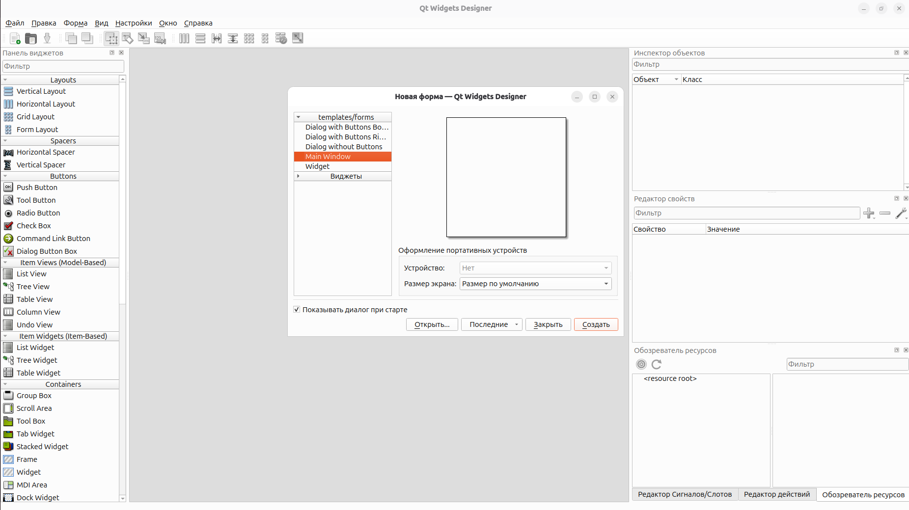
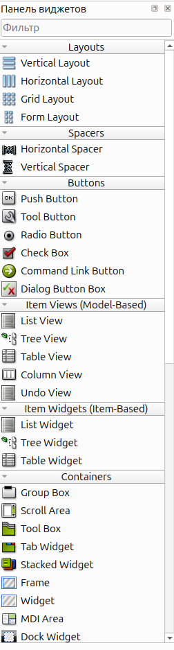
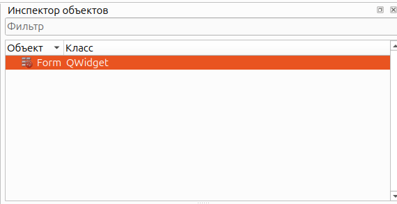
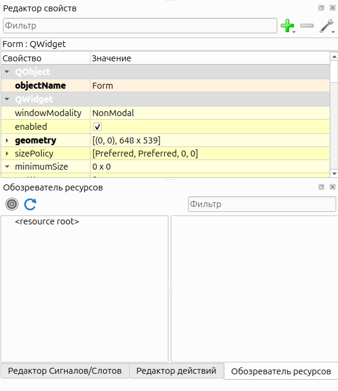
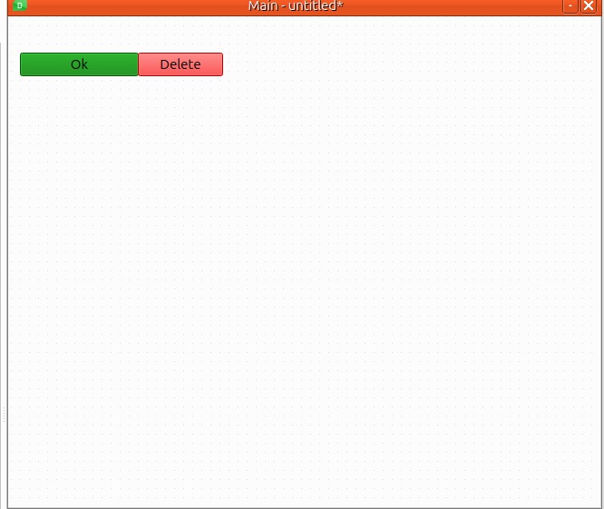
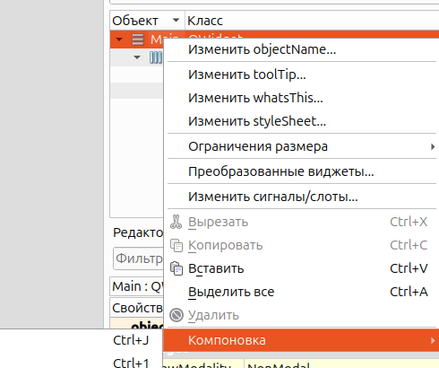

# Практическое занятие №12. Разработка приложения, тестирование. Дизайнер

Не всегда удобно писать визуальную часть приложения кодом, для упрощения создания визуальной части в pyside есть дизайнер. Зайдите в папку своего проекта и введите в терминал команду `pyside6-designer`, перед вами предстанет следующее окно:



Обратите внимание на templates/form, некоторые из указанных данных вам уже должны быть знакомы, например `Main Window` и `Widget`.

- `Main Window` – лавное окно приложения с меню, панелями инструментов и статусбаром, наследуется он от `QMainWindow`.
- `Widget` – наш универсальный пустой виджет, который подойдет под любую задачу, наследуется от `QWidget`.
Из незнакомого мы видим диалоговые окна, они в основном используются для создания диалоговых окон, например, окно подтверждения. Разные виды, это просто вопрос кнопок **ok** и **cancel**, если вы хотите создать окно с кнопками внизу окна, то для этого можно использовать `dialog with Buttons Bottom`, аналогично для кнопок справа `dialog with Buttons Right` или без кнопок.

**Попробуйте создать каждое из окон, обратите внимание на правую панель, что там появляется**

Давйте выберим пункт widget, дизайнер создаст окно, слева от окна мы увидем панель виджетов, где уже знакомые нам объекты:

<p align="center">
  
</p>

В правой части нашего дизайнера вы увидете испектор объектов,  нем вы увидете все созданные вами объекты:

<p align="center">
  
</p>

Ниже вы увидете редаткор свойств, выбрав любой объект, в этом меню вы сможете изменить его свойства (например размер кнопки):

<p align="center">
  
</p>

По центру экрана вы видете большое путое полотно, это и есть наш класс наследник от `QWidget`, по умолчанию он называется `Form`.

Давайте немного попрактикуемся, найдите в панели виджетов кнопки и добавьте их на ваше полотно, поменяйте отображаемый ими текст и задайте им осмысленные имена, после чего, в свойствах измените цвет кнопок, внизу пример того, что должно получиться:



Сейчас, кнопки наши расположены без `layout`, на скриншоте ниже вы можете увидеть как мы задаем наши `layout`, это компоновка.

<p align="center">
  
</p>

Но что более важно, это наши создаваемые файлы. Когда мы сохраним наш файл, мы получим файл с расширение .ui, чтобы привести его в более привычный для нас вид, воспользуемся командой:
```cmd
pyside6-uic example.ui -o example.py
```
С помощью этой команды мы сгенерируем из нашего ui привычный нам файл с классами, хоть и с небольшими отличиями от того, что мы писали ранее. Разберем пример

```Python

class Ui_Main(object):
    def setupUi(self, Main):

```

Вы могли обратить внимание, что мы наследуемся не от qWidget, а от object, сам по себе object является азовым классом для сех классов, явно мы его указывем для понимания того, что это не виджет, в функцию setupUi, мы передадим наше окно, и уже в этой функции мы создаем все наши виджеты.

```Python
        if not Main.objectName():
            Main.setObjectName(u"Main")
```
Данная строчка нужна, на случай если мы сами не задали нашему объекту имя. Функция `retranslateUi`, нужна для дальнейшего добавления перевода.

Теперь давайте наконец используем этот файл, создадим main и в нем напишем свой класс, но теперь помимо обычного наследования от например `qWidget`, нам требуется наследоваться от созданного нами Ui_Main, и внутри класса вызвать метод setupUi. После нам только останется написать и подключить слоты.

```Python
class MainWindow(QWidget, Ui_Main):
    def __init__(self):
        super().__init__()
        self.setupUi(self)
```

# Задания

---

### Задание 1. «Знакомство с Дизайнером»
Создайте в Qt Widgets Designer форму на основе шаблона `Widget`. Разместите на полотне три кнопки в ряд. Измените их отображаемый текст на «Старт», «Пауза» и «Стоп». В инспекторе объектов задайте им осмысленные имена (например, `btnStart`, `btnPause`, `btnStop`). Используя редактор свойств, задайте каждой кнопке свой цвет фона (например, через свойство `styleSheet`). Выровняйте кнопки горизонтально с помощью соответствующего `Layout`.

### Задание 2. «Диалоговое окно подтверждения»
Создайте форму на основе шаблона `Dialog with Buttons Bottom`. Разместите в ней метку с текстом «Вы уверены, что хотите удалить этот файл?».
Подключите стандартные кнопки `OK` и `Cancel` к слотам. При нажатии `OK` выводите в консоль сообщение «Файл удален», при нажатии `Cancel` — «Удаление отменено». Обе кнопки должны закрывать диалоговое окно.

### Задание 3. «Калькулятор»
Создайте форму `Main Window`. В центральной части разместите дисплей (метка или поле только для чтения) и сетку кнопок: цифры `0–9`, операции `+ − × ÷`, `=`, `C` (очистка), `←` (удаление последнего символа) и `.` (десятичная точка). Кнопки расположите через `QGridLayout`, дисплей — над сеткой в `QVBoxLayout`, чтобы при растягивании окна всё выглядело аккуратно. Задайте кнопкам разные цвета через `styleSheet`: цифры — один, операции — другой, `=` — третий.

В `main.py`:
- нажатие цифры и `.` дописывает символ в дисплей (точку нельзя ввести дважды в одном числе);
- нажатие операции запоминает текущее число и операцию, дисплей очищается под ввод следующего;
- `=` вычисляет результат и выводит его в дисплей;
- `C` сбрасывает всё, `←` удаляет последний символ;
- деление на ноль и некорректное выражение — показывайте `QMessageBox.warning` и не меняйте дисплей;
- в меню `Help → About` — `QMessageBox.about`.

Проверьте: цепочку операций (`2 + 3 × 4`), повторное нажатие `=`, деление на ноль, ввод точки, удаление до пустого дисплея.

